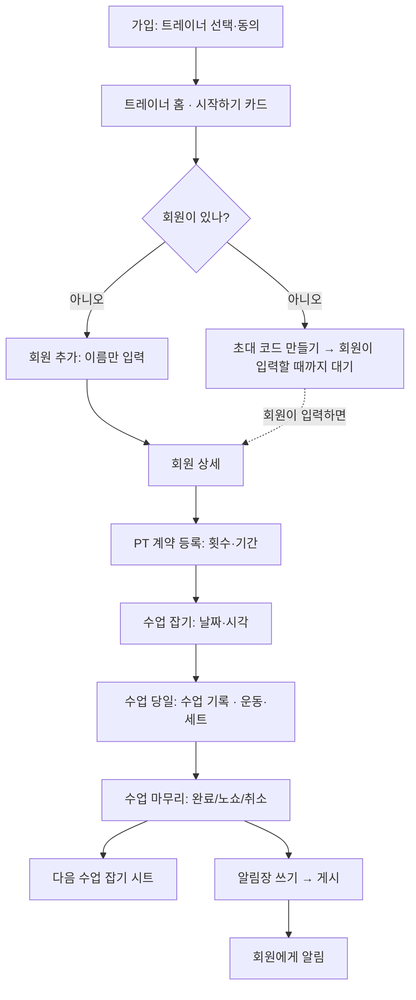
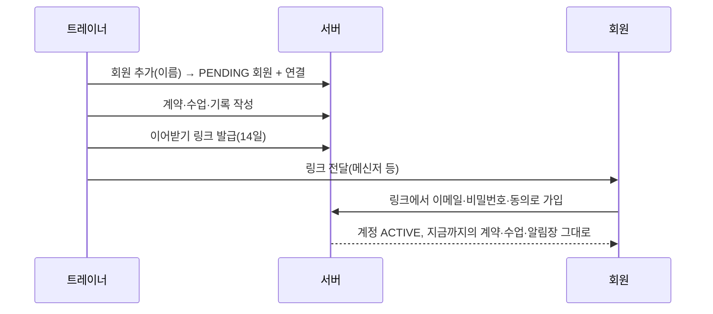
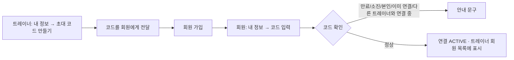
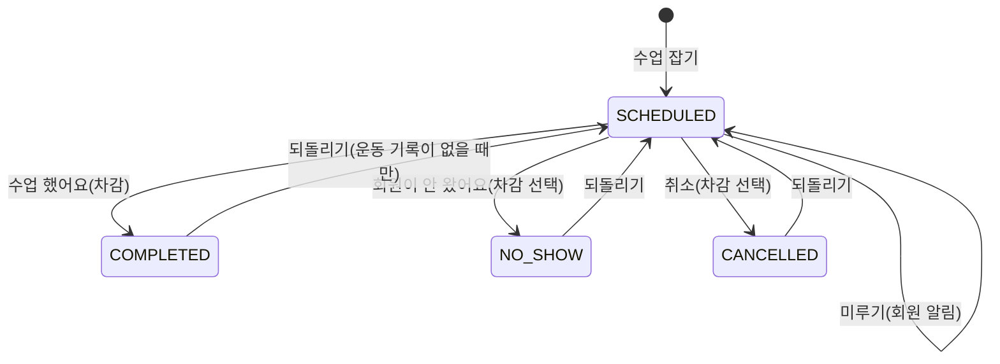
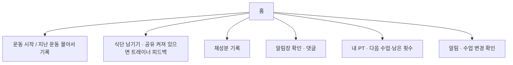
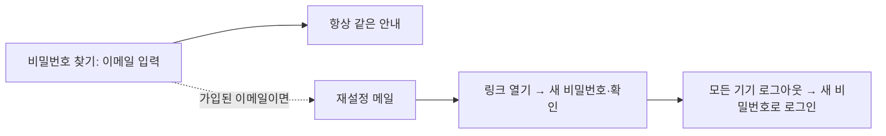
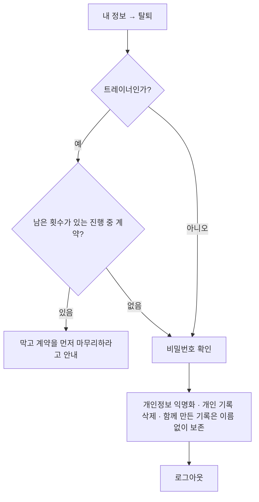

# 03. 화면 정의서 · 유저 플로우

화면 구성의 시각 규칙(색·간격·컴포넌트)은 디자인 시스템 문서가 기준이고, 여기서는 **어떤 화면이 있고 무엇을
하는지**를 정의한다. 모바일 우선, 하단 탭 내비게이션을 쓴다.

## 1. 내비게이션 구조

| 역할 | 하단 탭 |
| --- | --- |
| 회원 | 홈 `/home` · 운동 `/exercises` · 캘린더 `/calendar` · 알림장 `/journal` · 내정보 `/profile` |
| 트레이너 | 홈 `/trainer` · 일정 `/trainer/schedule` · 회원 `/trainer/members` · 할 일 `/trainer/journals` · 내 정보 `/trainer/profile` |

접근 제어: `proxy.ts` 가 세션 쿠키가 없으면 로그인으로 보내고(낙관적), 각 레이아웃·서비스가 DB 로 다시 확인한다.
회원 레이아웃은 트레이너를 `/trainer` 로, 트레이너 레이아웃은 회원을 `/home` 으로 돌려보낸다.

## 2. 화면 목록

### 2-1. 공통 (비로그인 포함)

| 화면 | 주소 | 구성·동작 |
| --- | --- | --- |
| 진입 | `/` | 로그인 상태면 역할에 맞는 홈으로, 아니면 로그인으로 보낸다 |
| 로그인 | `/login` | 이메일·비밀번호(보기 토글), 로그인, 비밀번호 찾기·가입 링크. 오류는 폼 위 안내 |
| 회원가입 | `/signup` | 유형(회원/트레이너) 선택, 이름·이메일·비밀번호·확인, 동의 4개(약관 링크). 오류 뒤에도 입력 유지 |
| 이어받기 가입 | `/signup?code=…` 링크 | 트레이너가 만든 계정을 이어받는 가입. 이름은 표시만, 이메일·비밀번호·확인·동의 |
| 비밀번호 찾기 | `/forgot-password` | 이메일 입력 → 항상 같은 안내 |
| 새 비밀번호 | `/reset-password?token=…` | 새 비밀번호·확인. 잘못되거나 만료된 링크는 거절 안내 |
| 이용약관 | `/terms` | 로그인 없이 열림, 돌아가기는 역할별 홈 진입점 |
| 개인정보처리방침 | `/privacy` | 위와 같음 |

### 2-2. 회원

| 화면 | 주소 | 구성·동작 |
| --- | --- | --- |
| 홈 | `/home` | 진행 중 운동 이어하기, 운동 시작·지난 운동 몰아서 기록, 이번 주 진행, 다음 수업과 수업 변경 확인, 최근 운동, 식단 바로가기 |
| 운동 라이브러리 | `/exercises` | 부위·기구·난이도 필터, 목록 범위(전체/즐겨찾기), 페이지 이동 |
| 운동 상세 | `/exercises/[id]` | 필요한 기구, 운동 방법, 호흡·주의, 즐겨찾기, "이 운동 기록하기" |
| 운동 기록 | `/workouts/[id]` | 운동 추가·순서, 세트 입력(즉시 반영), 종료. 몰아서 기록 모드 지원 |
| 운동 요약 | `/workouts/[id]/summary` | 시간·세트·볼륨 요약, 운동 시간 고치기, 운동별 추이 |
| 캘린더 | `/calendar` | 월 이동, 날짜별 운동·식단, 지난 날짜 선택 후 운동 기록 |
| 알림장 | `/journal` | 종류 필터(알림장/공지), 새로 온 소식 |
| 알림장 상세 | `/journal/[id]` | 본문·사진·섹션, 댓글 |
| 공지 | `/journal/notice/[id]` | 센터 공지 읽기(쓰는 화면은 없음) |
| 내 PT | `/sessions` | 남은 횟수·계약, 앞으로의 수업, 지난 회차, 변경 확인 |
| 식단 | `/diet` | 날짜별 목록, 트레이너 피드백 표시 |
| 식단 남기기 | `/diet/new` | 끼니, 사진, 음식 이름, 메모 |
| 식단 상세 | `/diet/[id]` | 사진·내용·피드백, 삭제 |
| 체성분 | `/body` | 추이, 기록 목록, 목표 진행 |
| 체성분 기록 | `/body/new` | 날짜, 체중·체지방·골격근·허리, 메모 |
| 목표 | `/body/goal` | 목표 종류·값·날짜 |
| 알림 | `/notifications` | 목록, 모두 읽음, 푸시 켜기·종류별 설정 |
| 내 정보 | `/profile` | 계정 요약, 트레이너 연결(코드 입력·끊기), 공유 설정 링크, 알림, 로그아웃 |
| 정보 수정 | `/profile/edit` | 이름·전화번호, 비밀번호 변경 |
| 트레이너와 공유 | `/profile/sharing` | 식단·사진·개인 운동·체성분 토글, 저장 후 `?saved=1` |
| 탈퇴 | `/profile/delete` | 안내 + 비밀번호 확인 |

### 2-3. 트레이너

| 화면 | 주소 | 구성·동작 |
| --- | --- | --- |
| 홈 | `/trainer` | **시작하기 카드**(첫 사용), 오늘 요약, 확인이 필요한 항목, 오늘 수업, 회원 카드 |
| 일정 | `/trainer/schedule` | 주/월 보기, 날짜 선택, 수업 추가 패널(회원·날짜·시각·진행 시간), 수업 카드(기록 열기) |
| 회원 목록 | `/trainer/members` | 이름 검색, 회원 추가(서랍: 이름·연락처), 초대 코드 만들기 |
| 회원 상세 | `/trainer/members/[id]` | 상단 새 알림장 쓰기, PT 계약(진행률), 수업 일정, 최근 수업, 알림장, 식단·개인 운동·몸의 변화(공유된 것만), 이어받기 링크(가입 전 회원) |
| 계약 등록 | `/trainer/members/[id]/contracts/new` | 횟수, 기간, 이름, 센터 |
| 계약 관리 | `/trainer/members/[id]/contracts/[contractId]` | 진행률, 수업 목록, 수업 잡기, 기간 연장, 계약 중단 |
| 공유 식단 | `/trainer/members/[id]/diet` | 회원이 공유한 식단 목록 |
| 식단 상세·피드백 | `/trainer/members/[id]/diet/[dietId]` | 사진·내용, 피드백 쓰기·삭제 |
| 회원 여정 | `/trainer/members/[id]/journey` | 함께한 기간의 변화 타임라인 |
| 수업 기록 | `/trainer/sessions/[id]` | 브리핑, 운동·세트 기록, 지난 운동 복사, 수업 마무리 모달, 다음 수업 시트 |
| 할 일 | `/trainer/journals` | 수업 완료 처리, 알림장 작성, 답장 대기 |
| 알림장 쓰기 | `/trainer/journals/[id]` | 제목·내용·섹션·사진, 임시 저장, 게시, 초안 삭제 |
| 알림장 미리보기 | `/trainer/journals/[id]/preview` | 회원에게 보이는 모습 |
| 알림 | `/trainer/notifications` | 목록, 푸시 설정 |
| 내 정보 | `/trainer/profile` | 소개, 초대 코드, 알림, 로그아웃 |
| 정보 수정 | `/trainer/profile/edit` | 이름·전화번호·활동 이름·전문 분야 등, 비밀번호 변경 |
| 탈퇴 | `/trainer/profile/delete` | 진행 중 계약 안내 + 비밀번호 확인 |

### 2-4. 서버 전용 주소

| 주소 | 용도 |
| --- | --- |
| `/api/exercises`, `/api/exercises/[id]` | 운동 목록·상세 |
| `/api/workouts/sessions`, `…/active`, `…/[id]`, `…/[id]/records` | 운동 세션 시작·조회·종료·운동 추가 |
| `/api/workouts/records/[id]`, `/api/workouts/sets/[id]`, `/api/workouts/last-record` | 운동 기록·세트 수정, 지난 기록 힌트 |
| `/api/cron/reminders` | 매일 알림(Vercel Cron, `CRON_SECRET` Bearer) |

대부분의 쓰기는 서버 액션(`app/**/actions.ts`)이 한다.

## 3. 공통 화면 규칙

- 오류는 폼 근처에 한국어 한 줄로 보인다(`role="alert"`). 서버 오류 화면(500)이 아니라 안내로 끝난다
- 서버 오류를 화면에 돌려주는 폼은 오류 뒤에도 입력을 유지한다(`useSubmitKeep`)
- 비어 있는 상태(수업 없음, 알림장 없음 등)에는 다음 행동을 안내하는 문구를 둔다. 긴 문장은 `keep-all`·`text-wrap` 으로 단어 중간에서 끊지 않는다
- 날짜·시간 입력은 iOS Safari 에서 칸을 넘치지 않게 공통 스타일을 쓴다
- 로딩 중에는 화면 뼈대(스켈레톤)를 먼저 보인다

## 4. 유저 플로우

### 4-1. 트레이너 첫 사용 (가입 → 첫 알림장)

### 4-2. 가입 전 회원 이어받기

### 4-3. 가입한 회원이 코드로 연결

### 4-4. 수업 마무리

### 4-5. 회원의 하루

### 4-6. 비밀번호 재설정

### 4-7. 탈퇴

