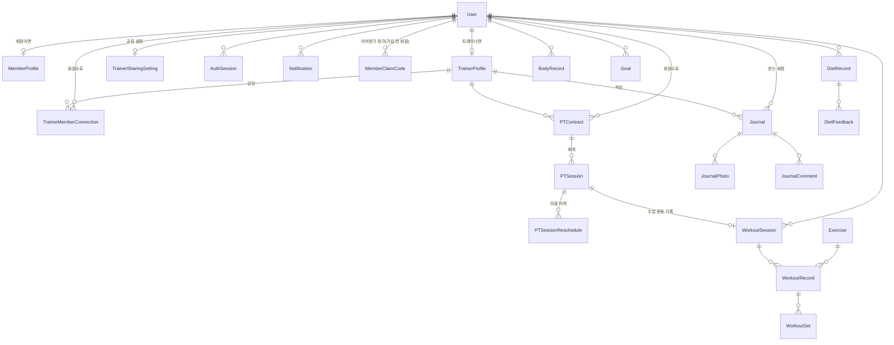

# 04. 데이터 모델 · 권한 정의서

원천은 `prisma/schema.prisma` 이다. 이 문서의 표는 스키마에서 뽑은 것이라 필드가 바뀌면 다시 뽑는다
(모든 표에 `id`, `createdAt`, `updatedAt` 이 있으면 생략했다). DB 는 Supabase Postgres 이고, ID 는 모두
uuid 문자열, 날짜는 UTC 로 저장하고 화면에서 KST 로 바꾼다.

## 1. 모델 한눈에 보기

핵심 관계 세 가지:

1. **계정은 하나, 역할은 프로필로 정한다.** `User` 에 `TrainerProfile` 이 있으면 트레이너, `MemberProfile` 이 있으면 회원이다. 한 계정은 한 역할만 갖는다
2. **트레이너–회원 관계는 `TrainerMemberConnection`** 한 줄이다(`ACTIVE`/`ENDED`). 센터는 필수가 아니다. **정책상 회원 한 명에게 `ACTIVE` 연결은 하나**다(코드 입력 때 서비스가 확인하고, DB 제약은 트레이너+회원 쌍의 유일성만 건다)
3. **수업(`PTSession`)이 계약(`PTContract`)·운동 기록(`WorkoutSession`)·알림장(`Journal`)을 잇는다**

## 2. 테이블 정의

### 2-1. 계정·인증

회원 탈퇴 시 `User` 는 지우지 않고 `status=DELETED`, `deletedAt` 을 채우고 이름·이메일·전화번호·비밀번호를 비운다. `email` 이 null 이면 로그인할 수 없다. 트레이너가 만든 가입 전 회원은 `status=PENDING`, `email`·`passwordHash` 가 null 이다.

#### `User`

| 필드 | 타입 | 필수 | 비고 |
| --- | --- | --- | --- |
| `email` | String? |  | unique |
| `passwordHash` | String? |  |  |
| `name` | String | O |  |
| `phone` | String? |  |  |
| `profileImageUrl` | String? |  |  |
| `status` | UserStatus | O | 기본 ACTIVE |
| `termsVersion` | String? |  |  |
| `termsAgreedAt` | DateTime? |  |  |
| `deletedAt` | DateTime? |  |  |
| `lastLoginAt` | DateTime? |  |  |

#### `AuthSession`

| 필드 | 타입 | 필수 | 비고 |
| --- | --- | --- | --- |
| `userId` | String | O |  |
| `expiresAt` | DateTime | O |  |
| `lastUsedAt` | DateTime? |  |  |
| `revokedAt` | DateTime? |  |  |

#### `AuthAttempt`

| 필드 | 타입 | 필수 | 비고 |
| --- | --- | --- | --- |
| `key` | String | O |  |

#### `PasswordResetToken`

| 필드 | 타입 | 필수 | 비고 |
| --- | --- | --- | --- |
| `userId` | String | O |  |
| `tokenHash` | String | O | unique |
| `expiresAt` | DateTime | O |  |
| `usedAt` | DateTime? |  |  |

#### `DeviceToken`

| 필드 | 타입 | 필수 | 비고 |
| --- | --- | --- | --- |
| `userId` | String | O |  |
| `token` | String | O | unique |
| `platform` | DevicePlatform | O |  |
| `deviceName` | String? |  |  |
| `isActive` | Boolean | O | 기본 true |
| `lastUsedAt` | DateTime? |  |  |

### 2-2. 프로필·연결·공유

#### `MemberProfile`

| 필드 | 타입 | 필수 | 비고 |
| --- | --- | --- | --- |
| `userId` | String | O | unique |
| `birthDate` | DateTime? |  |  |
| `gender` | String? |  |  |
| `heightCm` | Decimal? |  |  |
| `fitnessLevel` | String? |  |  |
| `primaryGoal` | String? |  |  |
| `onboardingDone` | Boolean | O | 기본 false |

#### `TrainerProfile`

| 필드 | 타입 | 필수 | 비고 |
| --- | --- | --- | --- |
| `bio` | String? |  |  |
| `specialty` | String? |  |  |
| `careerYears` | Int? |  |  |
| `profileImageUrl` | String? |  |  |
| `userId` | String | O | unique |
| `displayName` | String? |  |  |

#### `TrainerMemberConnection`

| 필드 | 타입 | 필수 | 비고 |
| --- | --- | --- | --- |
| `trainerProfileId` | String | O |  |
| `memberUserId` | String | O |  |
| `status` | ConnectionStatus | O | 기본 ACTIVE |
| `originCenterId` | String? |  |  |
| `startedAt` | DateTime | O | 기본 now() |
| `endedAt` | DateTime? |  |  |

복합 unique: `(trainerProfileId, memberUserId)`

#### `MemberClaimCode`

| 필드 | 타입 | 필수 | 비고 |
| --- | --- | --- | --- |
| `code` | String | O | unique |
| `memberUserId` | String | O |  |
| `trainerProfileId` | String | O |  |
| `expiresAt` | DateTime | O |  |
| `claimedAt` | DateTime? |  |  |
| `revokedAt` | DateTime? |  |  |

#### `TrainerInvitation`

| 필드 | 타입 | 필수 | 비고 |
| --- | --- | --- | --- |
| `trainerProfileId` | String | O |  |
| `code` | String | O | unique |
| `maxUses` | Int | O | 기본 50 |
| `usedCount` | Int | O | 기본 0 |
| `expiresAt` | DateTime | O |  |
| `revokedAt` | DateTime? |  |  |

#### `TrainerSharingSetting`

| 필드 | 타입 | 필수 | 비고 |
| --- | --- | --- | --- |
| `shareDiet` | Boolean | O | 기본 true |
| `shareDietPhoto` | Boolean | O | 기본 true |
| `sharePersonalWorkout` | Boolean | O | 기본 false |
| `shareBody` | Boolean | O | 기본 false |
| `userId` | String | O | unique |

### 2-3. PT 계약·수업

#### `PTContract`

| 필드 | 타입 | 필수 | 비고 |
| --- | --- | --- | --- |
| `productId` | String? |  |  |
| `title` | String | O |  |
| `totalSessions` | Int | O |  |
| `usedSessions` | Int | O | 기본 0 |
| `startedAt` | DateTime | O |  |
| `expiresAt` | DateTime? |  |  |
| `status` | PTContractStatus | O | 기본 ACTIVE |
| `memberUserId` | String | O |  |
| `trainerProfileId` | String | O |  |
| `centerId` | String? |  |  |

#### `PTSession`

| 필드 | 타입 | 필수 | 비고 |
| --- | --- | --- | --- |
| `contractId` | String | O |  |
| `sessionNumber` | Int | O |  |
| `scheduledAt` | DateTime | O |  |
| `durationMinutes` | Int | O | 기본 60 |
| `status` | PTSessionStatus | O | 기본 SCHEDULED |
| `memo` | String? |  |  |
| `completedAt` | DateTime? |  |  |
| `cancelledAt` | DateTime? |  |  |
| `cancelReason` | String? |  |  |
| `memberUserId` | String | O |  |
| `trainerProfileId` | String | O |  |
| `deducted` | Boolean | O | 기본 false |
| `cancelledBy` | PTSessionActor? |  |  |
| `memberAlertAt` | DateTime? |  |  |

복합 unique: `(contractId, sessionNumber)`

#### `PTSessionReschedule`

| 필드 | 타입 | 필수 | 비고 |
| --- | --- | --- | --- |
| `sessionId` | String | O |  |
| `fromScheduledAt` | DateTime | O |  |
| `toScheduledAt` | DateTime | O |  |
| `movedBy` | PTSessionActor | O |  |
| `reason` | String? |  |  |

### 2-4. 운동

#### `Exercise`

| 필드 | 타입 | 필수 | 비고 |
| --- | --- | --- | --- |
| `name` | String | O | unique |
| `bodyPart` | WorkoutBodyPart | O |  |
| `targetMuscle` | String? |  |  |
| `movementType` | ExerciseMovementType | O |  |
| `difficulty` | Difficulty | O |  |
| `description` | String? |  |  |
| `instruction` | String? |  |  |
| `breathing` | String? |  |  |
| `caution` | String? |  |  |
| `videoUrl` | String? |  |  |
| `thumbnailUrl` | String? |  |  |
| `isSystem` | Boolean | O | 기본 true |
| `isActive` | Boolean | O | 기본 true |

#### `Equipment`

| 필드 | 타입 | 필수 | 비고 |
| --- | --- | --- | --- |
| `name` | String | O | unique |
| `category` | EquipmentCategory | O |  |
| `description` | String? |  |  |
| `imageUrl` | String? |  |  |
| `isSystem` | Boolean | O | 기본 true |
| `isActive` | Boolean | O | 기본 true |

#### `ExerciseEquipment`

| 필드 | 타입 | 필수 | 비고 |
| --- | --- | --- | --- |
| `exerciseId` | String | O |  |
| `equipmentId` | String | O |  |
| `isPrimary` | Boolean | O | 기본 false |

복합 unique: `(exerciseId, equipmentId)`

#### `WorkoutSession`

| 필드 | 타입 | 필수 | 비고 |
| --- | --- | --- | --- |
| `userId` | String | O |  |
| `routineId` | String? |  |  |
| `startedAt` | DateTime | O |  |
| `endedAt` | DateTime? |  |  |
| `durationSec` | Int? |  |  |
| `status` | WorkoutSessionStatus | O | 기본 IN_PROGRESS |
| `memo` | String? |  |  |
| `entryMode` | WorkoutEntryMode | O | 기본 LIVE |
| `recordedByUserId` | String? |  |  |
| `ptSessionId` | String? |  | unique |

#### `WorkoutRecord`

| 필드 | 타입 | 필수 | 비고 |
| --- | --- | --- | --- |
| `sessionId` | String | O |  |
| `exerciseId` | String | O |  |
| `orderIndex` | Int | O | 기본 0 |
| `note` | String? |  |  |
| `totalVolume` | Decimal? |  |  |
| `userId` | String | O |  |

#### `WorkoutSet`

| 필드 | 타입 | 필수 | 비고 |
| --- | --- | --- | --- |
| `recordId` | String | O |  |
| `setNumber` | Int | O |  |
| `weight` | Decimal? |  |  |
| `reps` | Int? |  |  |
| `restSeconds` | Int? |  |  |
| `completed` | Boolean | O | 기본 true |
| `rpe` | Decimal? |  |  |
| `note` | String? |  |  |

복합 unique: `(recordId, setNumber)`

#### `WorkoutFavorite`

| 필드 | 타입 | 필수 | 비고 |
| --- | --- | --- | --- |
| `userId` | String | O |  |
| `exerciseId` | String | O |  |

복합 unique: `(userId, exerciseId)`

### 2-5. 식단·체성분·목표

#### `DietRecord`

| 필드 | 타입 | 필수 | 비고 |
| --- | --- | --- | --- |
| `userId` | String | O |  |
| `date` | DateTime | O |  |
| `mealType` | DietMealType | O |  |
| `foodName` | String? |  |  |
| `amount` | String? |  |  |
| `calories` | Decimal? |  |  |
| `carbohydrate` | Decimal? |  |  |
| `protein` | Decimal? |  |  |
| `fat` | Decimal? |  |  |
| `memo` | String? |  |  |
| `aiAnalyzed` | Boolean | O | 기본 false |
| `aiResult` | Json? |  |  |
| `imagePath` | String? |  |  |
| `thumbnailPath` | String? |  |  |

#### `DietFeedback`

| 필드 | 타입 | 필수 | 비고 |
| --- | --- | --- | --- |
| `dietRecordId` | String | O |  |
| `content` | String | O |  |
| `trainerProfileId` | String | O |  |

#### `BodyRecord`

| 필드 | 타입 | 필수 | 비고 |
| --- | --- | --- | --- |
| `userId` | String | O |  |
| `recordedAt` | DateTime | O |  |
| `weightKg` | Decimal? |  |  |
| `bodyFatPercent` | Decimal? |  |  |
| `skeletalMuscleKg` | Decimal? |  |  |
| `waistCm` | Decimal? |  |  |
| `memo` | String? |  |  |
| `imageUrl` | String? |  |  |

복합 unique: `(userId, recordedAt)`

#### `Goal`

| 필드 | 타입 | 필수 | 비고 |
| --- | --- | --- | --- |
| `userId` | String | O |  |
| `type` | GoalType | O |  |
| `title` | String | O |  |
| `description` | String? |  |  |
| `targetValue` | Decimal? |  |  |
| `unit` | String? |  |  |
| `startDate` | DateTime | O |  |
| `targetDate` | DateTime? |  |  |
| `status` | GoalStatus | O | 기본 ACTIVE |
| `startValue` | Decimal? |  |  |

### 2-6. 알림장·알림

#### `Journal`

| 필드 | 타입 | 필수 | 비고 |
| --- | --- | --- | --- |
| `ptSessionId` | String? |  |  |
| `date` | DateTime | O |  |
| `title` | String? |  |  |
| `content` | String | O |  |
| `status` | JournalStatus | O | 기본 DRAFT |
| `workoutSummary` | String? |  |  |
| `dietGuidance` | String? |  |  |
| `caution` | String? |  |  |
| `nextGoal` | String? |  |  |
| `publishedAt` | DateTime? |  |  |
| `memberReadAt` | DateTime? |  |  |
| `memberUserId` | String | O |  |
| `trainerProfileId` | String | O |  |

#### `JournalPhoto`

| 필드 | 타입 | 필수 | 비고 |
| --- | --- | --- | --- |
| `journalId` | String | O |  |
| `orderIndex` | Int | O | 기본 0 |
| `storagePath` | String | O |  |
| `thumbnailPath` | String? |  |  |

#### `JournalComment`

| 필드 | 타입 | 필수 | 비고 |
| --- | --- | --- | --- |
| `journalId` | String | O |  |
| `content` | String | O |  |
| `deletedAt` | DateTime? |  |  |
| `authorUserId` | String | O |  |

#### `Notification`

| 필드 | 타입 | 필수 | 비고 |
| --- | --- | --- | --- |
| `userId` | String | O |  |
| `type` | NotificationType | O |  |
| `title` | String | O |  |
| `message` | String | O |  |
| `relatedType` | String? |  |  |
| `relatedId` | String? |  |  |
| `isRead` | Boolean | O | 기본 false |
| `readAt` | DateTime? |  |  |

#### `NotificationPreference`

| 필드 | 타입 | 필수 | 비고 |
| --- | --- | --- | --- |
| `userId` | String | O |  |
| `type` | NotificationType | O |  |
| `pushEnabled` | Boolean | O | 기본 true |

복합 unique: `(userId, type)`

#### `Notice`

| 필드 | 타입 | 필수 | 비고 |
| --- | --- | --- | --- |
| `centerId` | String | O |  |
| `authorMembershipId` | String | O |  |
| `scope` | NoticeScope | O | 기본 CENTER |
| `title` | String | O |  |
| `content` | String | O |  |
| `pinnedAt` | DateTime? |  |  |
| `publishedAt` | DateTime? |  |  |

#### `NoticeRead`

| 필드 | 타입 | 필수 | 비고 |
| --- | --- | --- | --- |
| `noticeId` | String | O |  |
| `membershipId` | String | O |  |
| `readAt` | DateTime | O | 기본 now() |

복합 unique: `(noticeId, membershipId)`

### 2-7. 상태값(enum)

| enum | 값 |
| --- | --- |
| `UserStatus` | `ACTIVE` · `INACTIVE` · `SUSPENDED` · `DELETED` · `PENDING` |
| `ConnectionStatus` | `ACTIVE` · `ENDED` |
| `PTContractStatus` | `ACTIVE` · `COMPLETED` · `EXPIRED` · `CANCELLED` |
| `PTSessionStatus` | `SCHEDULED` · `COMPLETED` · `CANCELLED` · `NO_SHOW` |
| `PTSessionActor` | `MEMBER` · `TRAINER` |
| `WorkoutEntryMode` | `LIVE` · `MANUAL` |
| `WorkoutSessionStatus` | `IN_PROGRESS` · `COMPLETED` · `CANCELLED` |
| `JournalStatus` | `DRAFT` · `PUBLISHED` |
| `DietMealType` | `BREAKFAST` · `LUNCH` · `DINNER` · `SNACK` · `OTHER` |
| `GoalType` | `WEIGHT` · `BODY_FAT` · `MUSCLE_MASS` · `WORKOUT_FREQUENCY` · `EXERCISE_PR` · `CUSTOM` |
| `GoalStatus` | `ACTIVE` · `COMPLETED` · `CANCELLED` |
| `NotificationType` | `JOURNAL_CREATED` · `PT_SESSION_REMINDER` · `PT_SESSION_CHANGED` · `PT_CONTRACT_EXPIRING` · `GENERAL` |

운동 정보용 enum(`WorkoutBodyPart`, `EquipmentCategory`, `ExerciseMovementType`, `Difficulty`)은 스키마를 본다.

### 2-8. 스키마만 있고 화면이 없는 모델

`Center` · `CenterMembership` · `CenterInvitation` · `Gym` · `GymEquipment` · `MemberEquipment` · `PTProduct` ·
`TrainerPTPrice` · `Routine` · `RoutineExercise` · `WorkoutAlternative` · `AiAnalysis`

센터·상품·기구 프리셋은 센터 관리자 기능을 위한 자리이고, 지금 앱은 개인 트레이너 기준으로 동작한다(`Center` 는
계약의 선택 항목, `Notice` 읽기에만 쓰인다). `AiAnalysis` 는 나중에 AI 기능을 붙일 때를 위한 자리다.

## 3. 권한 정의서

### 3-1. 원칙

1. **2단계 방어.** `proxy.ts` 는 쿠키(JWT 서명)만 보는 낙관적 보호이고, 실제 방어선은 서버의 DB 조회다
   (`app/lib/dal.ts` 의 `requireUser`, 서비스의 `requireTrainerProfile`·`requireMyMember`·`requireMyContract`·`requireMySession`)
2. **서버 액션과 서비스는 항상 다시 확인한다.** 화면에서 버튼을 숨기는 것은 권한이 아니다
3. **회원의 데이터에 트레이너가 닿는 길은 하나다.** `assertTrainerCanView(트레이너, 회원 연결, 종류)` — 트레이너 활동 중 →
   내 담당(ACTIVE) 회원 → 그 종류를 공유함. 앞의 둘이 어긋나면 "없는 사람"(404)이고, 마지막만 "공유하지 않았어요"
4. **소유 확인은 조회 조건에 넣는다.** `findFirst({ where: { id, trainerProfileId } })` 처럼 남의 것은 "없음"과 같게 나온다
5. 읽기 전용 외부 입력(주소의 `?error=` 등)은 코드로만 받고 문구는 화면이 고른다

### 3-2. 권한 매트릭스

R 읽기 · C 만들기 · U 수정 · D 삭제. "담당" = ACTIVE 연결이 있는 트레이너.

| 자원 | 본인(회원) | 담당 트레이너 | 다른 트레이너 | 비로그인 |
| --- | --- | --- | --- | --- |
| 계정·내 정보 | RU, 탈퇴 | 담당 회원의 이름 등 최소 정보 R | — | — |
| 가입 전 회원(PENDING) | (가입으로 이어받기) | CR(자기가 만든 회원), 이어받기 링크 발급 | — | 링크로 가입만 |
| 공유 설정 | RU | 효과 값 R | — | — |
| PT 계약·회차 | R(자기 것) | CRU, 중단·연장 | — | — |
| 수업 상태 처리(완료·노쇼·취소·되돌리기) | — | U | — | — |
| 수업 운동 기록 | R | CRUD | — | — |
| 알림장 | R(게시된 것만), 댓글 C | CRU(자기가 쓴 것, 초안만 D), 댓글 C | — | — |
| 개인 운동 기록 | CRUD | R — `개인 운동` 공유 시, 관계 시작일부터 | — | — |
| 식단·식단 사진 | CRUD | R — `식단`/`식단 사진` 공유 시, 관계 시작일부터 | — | — |
| 식단 피드백 | R | CRD(자기가 쓴 것) — 식단 공유 시, 관계 시작 전 식단은 불가 | — | — |
| 체성분 기록 | CRUD | R(숫자만, 메모 제외) — `체성분` 공유 시, 관계 시작일부터 | — | — |
| 체성분 목표 | CRUD | **공유 대상 아님** | — | — |
| 알림·푸시 설정 | RU(본인) | RU(본인) | — | — |
| 초대 코드 | 입력(redeem) | CR·취소(자기 것) | — | — |
| 운동 라이브러리(공통 데이터) | R, 즐겨찾기 | R | R | 화면은 로그인 필요. `/api/exercises` 는 인증 없이 읽힘(민감 정보 아님) |
| 약관·처리방침 | R | R | R | R |
| `/api/cron/reminders` | — | — | — | `CRON_SECRET` Bearer 만 |

### 3-3. 역할 분리

- 가입 때 고른 쪽 프로필만 만든다. 한 계정은 한 역할
- 회원이 트레이너 화면(`/trainer/**`)에 들어가면 `/home` 으로, 트레이너가 회원 화면에 들어가면 `/trainer` 로 돌려보낸다
- 센터 관리자(`CENTER_ADMIN`) 역할은 가입 화면에서 고를 수 없다(권한 상승 통로가 되므로)

### 3-4. 인증 보호

| 항목 | 값 |
| --- | --- |
| 세션 | JWT(쿠키) 7일 + `AuthSession` 행, 폐기하면 즉시 무효 |
| 로그인 제한 | 계정+IP 15분 5회 · IP 15분 20회 (실패만) |
| 가입 제한 | IP 1시간 10회 |
| 이어받기 제한 | IP 15분 10회 (실패만) |
| 재설정 제한 | IP 1시간 10회 · 계정 1시간 3회 |
| 비밀번호 | bcrypt, 72바이트 이하 |
| 사진 | 비공개 저장소, 서명 주소로만 노출. 경로는 형식을 검증한다 |

## 4. 데이터 보존·삭제

| 대상 | 정책 |
| --- | --- |
| 회원 탈퇴 | 사용자 행 익명화. 개인 기록 삭제(식단·사진·체성분·목표·개인 운동·즐겨찾기·알림). 함께 만든 기록은 이름 없이 보존 |
| 트레이너 탈퇴 | 소개 삭제, 연결 종료. 진행 중 계약이 있으면 불가 |
| 연결 끊기 | 연결 `ENDED`. 트레이너의 공유 항목 열람 중단. 지난 계약·수업·알림장 보존 |
| 계약 중단 | 상태만 `CANCELLED`, 남은 수업은 차감 없이 취소. 기록 보존 |
| 로그 | `AuthSession` 은 만료·폐기 1일 뒤 로그인 때 정리. `AuthAttempt` 는 시도 제한 창 이후 의미 없음 |
| 백업 | Supabase 기본 백업 외 수동 백업 정책은 아직 없음 |

## 5. 알려진 한계

- 트레이너에게 숨기는 "관계 시작 전 기록 자르기"(`since`)는 `getLastRecord` 힌트에는 적용되지 않는다. 지난 PT 이력이 없을 때,
  공유를 켠 회원의 관계 시작 전 개인 운동이 "지난 기록 힌트"로 보일 수 있다
- 누가 언제 무엇을 봤는지 남기는 `DataAccessLog` 가 없다. 지금은 공유가 꺼져 있으면 조회 자체를 하지 않는 것으로 대신한다
- 이메일 소유 확인(인증)이 없어 가입한 주소가 본인 것인지 알 수 없다
- 한 회원 한 트레이너는 서비스 코드로만 막는다. 이 정책 이전에 이미 두 트레이너와 연결된 회원이 있다면 그대로 남는다(운영 DB 확인 필요). 정책을 풀려면 공유 설정을 트레이너별로 나누고 공유 설정 화면이 모든 담당 트레이너를 보여주도록 먼저 고쳐야 한다
